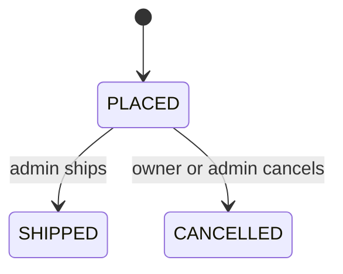
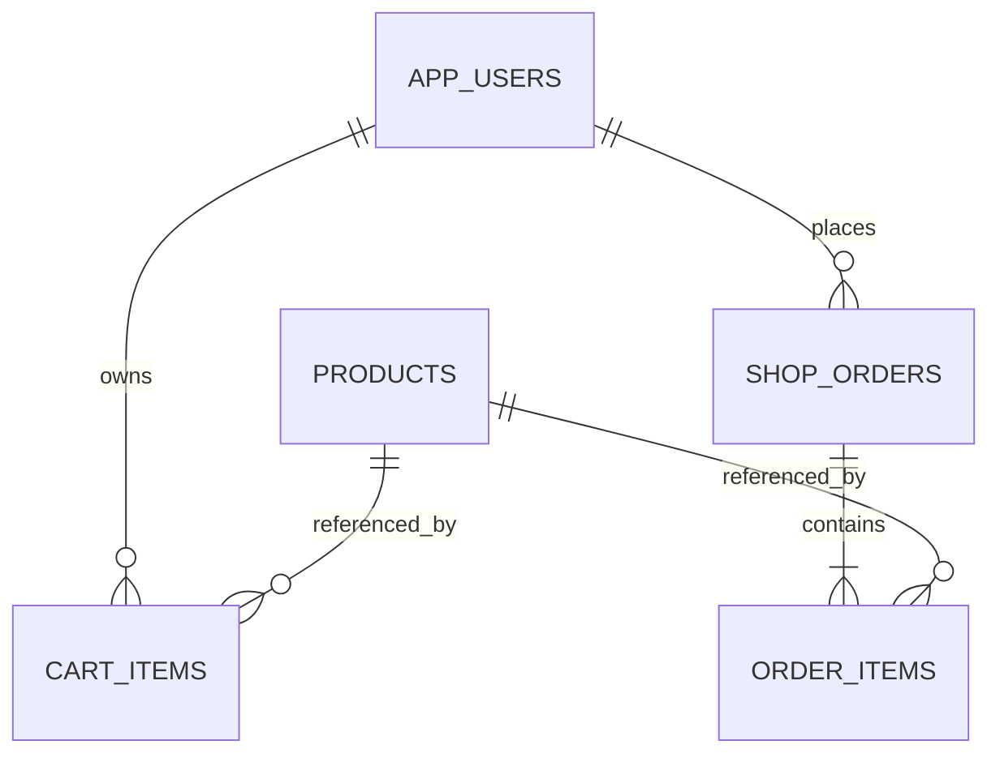

# OrderFlow

A Java backend for a small store: product catalogue, personal carts, transactional checkout and order fulfilment. The central feature is **correct inventory and order creation under concurrent requests and retries**.

**Stack:** Java 17, Spring Boot 4.1, Spring Security / JWT, PostgreSQL, Spring Data JPA, Flyway, Redis, JUnit, Mockito, Testcontainers, OpenAPI, Docker Compose and GitHub Actions.

[Русский разбор кода, базы данных и навыков для резюме](docs/LEARNING-RU.md)

## What it demonstrates

- Database transactions: create an order, snapshot prices, decrement stock and clear the cart atomically.
- Concurrency: pessimistic row locks prevent overselling; product locks use ascending IDs.
- Idempotency: retries with the same user and UUID key return the existing order without another stock decrement.
- Money: `BigDecimal`, `NUMERIC` columns and immutable order line prices; single currency KZT.
- Redis: JSON product metadata with a 60-second TTL, eviction after committed edits and database fallback on cache failure.
- SQL modelling: five tables, foreign keys, uniqueness/check constraints and query indexes.
- Security: BCrypt passwords, signed JWTs, USER/ADMIN roles and order ownership checks.
- Testing: the same HTTP contract runs on local H2 and on real PostgreSQL/Redis through Testcontainers.

## Quick local demo

Requires **JDK 17+**; the Maven wrapper downloads Maven. On Windows, set `JAVA_HOME` to a JDK if your default Java is older.

```powershell
.\mvnw.cmd spring-boot:run "-Dspring-boot.run.profiles=demo"
```

On macOS/Linux:

```bash
./mvnw spring-boot:run -Dspring-boot.run.profiles=demo
```

Open [Swagger UI](http://localhost:8080/swagger-ui.html). The demo binds to `127.0.0.1`, uses an in-memory H2 database and disables Redis. Data is lost on restart.

Demo administrator: `admin@example.com` / `OrderFlowDemo2026!`. These public credentials apply only to the local demo profile. Normal configuration requires your own JWT secret and optional bootstrap administrator credentials.

From another PowerShell terminal:

```powershell
.\scripts\demo.ps1
```

The script creates a product and buyer, checks out two units, retries with the same key, then cancels twice and verifies stock was restored only once. It does not print tokens.

## PostgreSQL and Redis with Docker

```powershell
.\scripts\init-env.ps1
docker compose up --build
```

On macOS/Linux, copy `.env.example` to `.env` and replace all placeholders with random secrets, for example using `openssl rand -base64 32`.

The app is exposed only at `127.0.0.1:8080`. PostgreSQL and Redis have no host ports. PostgreSQL uses a persistent volume; Redis is disposable cache storage. `docker compose down` stops the services without deleting the database volume. Keep `.env` private; it is excluded from Git and Docker builds.

## API overview

All endpoints below require a bearer token except registration, login, health and OpenAPI. In Swagger, log in and paste `accessToken` into **Authorize**.

| Method | Path | Purpose |
|---|---|---|
| POST | `/api/auth/register` | Register a USER |
| POST | `/api/auth/login` | Obtain a one-hour JWT |
| GET | `/api/auth/me` | Current user |
| GET | `/api/products` | Active products; `query`, `minPrice`, `maxPrice`, `sort`, `page`, `size` |
| GET | `/api/products/{id}` | Cached metadata, including active flag; no stock |
| GET | `/api/products/{id}/stock` | Current stock from the database |
| POST | `/api/admin/products` | ADMIN: create a product |
| PUT | `/api/admin/products/{id}` | ADMIN: edit name, price and active flag |
| POST | `/api/admin/products/{id}/stock` | ADMIN: add/remove stock with signed `delta` |
| GET | `/api/cart` | Personal cart and estimated total |
| PUT | `/api/cart/items/{productId}` | Set absolute quantity from 1 to 99 |
| DELETE | `/api/cart/items/{productId}` | Remove an item |
| DELETE | `/api/cart` | Clear the cart |
| POST | `/api/orders` | Checkout; requires `Idempotency-Key` UUID header |
| GET | `/api/orders/mine` | Paginated own order summaries |
| GET | `/api/orders/{id}` | Order detail; owner or ADMIN |
| POST | `/api/orders/{id}/cancel` | Cancel and restore stock; owner or ADMIN |
| POST | `/api/admin/orders/{id}/ship` | ADMIN: mark as shipped |

Create product body:

```json
{"sku":"KEYBOARD-01","name":"Keyboard","price":12500.50,"stock":10}
```

Cart body: `{"quantity":2}`. Checkout body: `{"shippingAddress":"Astana demo address"}`. Prices are selected from the database; clients cannot submit an order total or unit price.

Product `sort` accepts `id`, `priceAsc` and `priceDesc`. Page size is limited to 100. Carts support up to 50 distinct products. Adding a product to a cart does **not** reserve inventory.

Domain/input errors use Problem Details. Typical statuses: `400` invalid request, `401` unauthenticated, `403` wrong role, `404` unknown/inaccessible resource and `409` stock, lifecycle or idempotency conflict. Inaccessible orders return `404` to avoid exposing another user's data.

## Transaction and retry semantics

Checkout uses `READ_COMMITTED` and this sequence:

1. Lock the user row, shared by all mutations of that user's cart and all their checkouts.
2. Look for `(user_id, idempotency_key)`. Return the prior order for the same normalized address; reject a different address with `409`.
3. Read cart item IDs and quantities. An empty cart returns `409`.
4. Lock products in ascending ID order, then read their current price, active status and stock.
5. Decrement stock, create order lines with price/name/SKU snapshots, and clear the cart in one transaction.

The first successful request returns `201`; a replay returns `200` with `Idempotency-Replayed: true`. Replays return the order's **current** status. The key refers to the cart captured by the first successful request: later cart changes are not consumed by a replay. Use a new key for a new purchase. Failed transactions do not reserve the key, so the same key can succeed after stock is replenished. Keys are scoped to a user and retained with their orders.

Order lifecycle:



Cancellation locks the order, restores its quantities once and changes status atomically. Repeated cancellation is a no-op. Shipping is idempotent; cancelled orders cannot ship, and shipped orders cannot be cancelled. Every inventory writer follows the same product row-lock protocol.

## Cache boundaries

Redis stores only product metadata as JSON under `orderflow:product:v1:{id}` for 60 seconds. Stock, carts and orders are never cached. Catalogue lists and checkout read PostgreSQL directly. Product edits evict the corresponding cache entry after the database commit.

The catalogue is eventually consistent: a concurrent read can repopulate an older snapshot around eviction, and failed eviction leaves the entry until TTL expiry. Checkout always uses locked database values, so stale catalogue data cannot change an order price or permit overselling. Redis failures fall back to the database; they may add up to the configured timeout to catalogue requests. The overall health endpoint includes Redis in normal mode, even though catalogue fallback remains available.

## Database



Flyway creates the schema; Hibernate validates it. Unique constraints cover email, SKU, cart user/product pairs and order user/key pairs. Checks reject negative stock, invalid quantities, nonpositive prices and invalid statuses. Indexes support active catalogue ordering and a user's order history. Substring name search is intentionally simple and does not claim an indexed full-text search. `open-in-view` is disabled; DTOs are assembled inside service transactions. Cart display loads products in a batch, and order listing uses summaries without loading each order's lines.

## Tests

Without Docker:

```powershell
.\mvnw.cmd verify
```

With Docker available, run the same contract against disposable PostgreSQL and Redis containers plus cache-specific tests:

```powershell
.\mvnw.cmd -Pcontainers verify
```

The container profile requires Docker and fails if it is unavailable; it does not silently skip integration tests. GitHub Actions runs this profile, builds the application Docker image and validates Compose configuration. Reports are uploaded as CI artifacts.

Tests exercise authentication, ownership, money calculations, price snapshots, rollback, last-item races, six concurrent retries, cancellation, shipping, stock constraints, product filters and Redis expiry/invalidation. Only use disposable test databases: the HTTP test setup deletes application rows before each case.

## Scope

This is a portfolio backend, not a deployed store. There is no payment processing, tax/shipping-fee calculation, frontend, email delivery or real shipping integration. A placed order immediately reduces available stock; it does not represent confirmed payment. JWT refresh/revocation, login rate limiting and production monitoring are future work. Never expose the demo profile publicly.

## References

- [Spring Data Redis](https://docs.spring.io/spring-data/redis/reference/)
- [PostgreSQL explicit locking](https://www.postgresql.org/docs/17/explicit-locking.html)
- [Testcontainers PostgreSQL module](https://java.testcontainers.org/modules/databases/postgres/)
